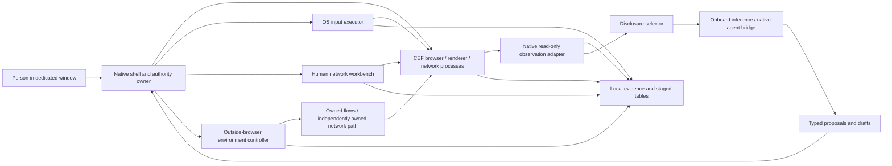

# Bow Shock design

Design proposal, 2026-10-01. The research phase has produced a concrete browser
architecture and interaction contract. This is the design phase: choices below
are proposals, product code has not begun, and dependencies have not been adopted.
The [research synthesis](../research-synthesis.md) and [source corpus](../../papers/README.md)
remain the evidence base. The design's adversarial review and dispositions belong
in [the tribunal report](../../papers/design-tribunal.md).

Bow Shock is a dedicated, visible browser where the person browses normally,
an onboard model reads selected native session state, and a coding agent can
collaborate over a native channel. The model proposes intent. The host checks
current state and authority; a separate executor realizes accepted intent with
OS keyboard, pointer and wheel events. Human traffic editing, environmental
experiments and reviewed table extraction are equal parts of the product.

## Read the design

| Specification | Owns |
| --- | --- |
| [Session authority and OS input](control-and-input.md) | Grants, mode transitions, takeover, native delivery, adaptive behavior and its limits |
| [Runtime and native observation](runtime-observation.md) | CEF process/thread lifetime, DOM/AX/frame identity, visibility, geometry and coverage |
| [Agent and model bridge](agent-bridge.md) | Provider scope, typed proposals, Codex protocol, approvals, reconnect and ambient privilege |
| [Network control](network-control.md) | Human request/response workbench, pause/send ownership, outside-browser interventions and cleanup |
| [Evidence and tables](evidence-and-tables.md) | Local event history, tracker baselines/alerts, Jev advice and reviewed DOM-to-DB rows |
| [Local controls concept](controls.svg) | Representative desktop layout; illustrative content, not an implemented browser |

## Proposed runtime and ownership

The working engine proposal is windowed CEF with Chrome bootstrap and Chrome-style
runtime, preserving ordinary engine defaults initially. A small C++ adapter owns
CEF integration. A native desktop shell presents content and controls; the
host authority/evidence services can be written in Rust, with small macOS-native
helpers for AppKit/Quartz and entitlement-dependent networking. The exact shell
language/FFI boundary remains a pre-adoption decision, not a commitment to a
large binding framework. SQLite plus bounded blob storage is the working local
storage proposal. None of these libraries/toolchains has been added to the repo.

The diagram shows logical owners, not a separate process for every box. Engine
process isolation remains intact. The authority owner serializes grants and
revocation; effects cross explicit service interfaces. Native IO callbacks never
wait for a human or model. The input/environment helpers contain the platform
privileges and bounded recovery logic; the inference adapter holds no actuator
handles. The CEF adapter's internal CDP observation path has no public debug
listener and no generic model-facing command relay.

The design distinguishes a constrained browser-model role from a trusted coding
agent with ambient shell privileges. Browser APIs can constrain cooperative
requests from a coding agent, but cannot sandbox its other same-UID powers.
No-direct-model-driving is enforced for the constrained role; it is a cooperation
contract for a trusted peer until a separate deployment containment design exists.

| Proposed decision | Reason | Alternative / adoption gate |
| --- | --- | --- |
| CEF Chrome-style, native owned window | Full engine/native access and dedicated profile/process ownership | Qt WebEngine remains the main fallback; measure candidate CEF sandbox, servicing, permissions and compatible browsing first |
| C++ engine adapter, compact native helpers, Rust host services | Keep CEF's native lifetime boundary explicit and centralize authority/state | Evaluate actual ABI/UI/build complexity before choosing bindings/shell framework |
| Private native observation adapter | Read rendered state without a public CDP control server | Internal target/session routing and OOPIF coverage must be measured on candidate binary |
| Model proposals through host validators | Separate inference from authority and native gesture realization | Trusted coding-agent ambient execution remains outside this boundary |
| Codex App Server over owned child stdio | Native conversation/control lifecycle without a network listener | Versioned schema/role probe; dynamic tools optional and experimentally gated; external MCP remains an alternative direction |
| Provider-neutral local or hosted inference | Onboard orchestration need not imply a particular provider/locality | Each export is scoped; no automatic provider fallback; local-only mode remains available |
| SQLite and bounded blob store | Local relational evidence, transactional reviewed rows and inspectable retention | Storage/schema/key management and crash consistency reviewed before adoption |
| Narrow external fault capabilities | Actual outside-browser transport/environment changes with owned cleanup | macOS packet/link confinement is unresolved; unsupported profiles stay unavailable |

## One useful tandem workflow

Working anchor, pending optional operator preference: compare pages and extract
a reviewed table. The network-investigation and bounded-action workflows below
remain core requirements regardless of which prototype demonstrates first.

1. The person opens a product/list/detail page in the dedicated window and enables
   observation for named origins. The browser shows which frames and modalities
   are included and whether the selected provider will receive them.
2. The person selects a representative row and asks for a table with named columns.
   The model proposes a page family/schema and shows grounded sample fields.
   The person corrects meanings, units and row boundaries.
3. Further rows require scrolling or navigation. The person grants a finite task:
   this tab, declared origin set, bounded forward scrolls and expected page
   transitions, maximum gesture count and elapsed time, no unreviewed final
   submission. The grant records the chosen provider's disclosure scope separately.
4. The model proposes the next semantic action from a fresh snapshot. The host
   reserves budget, checks target/focus/document, and the OS executor produces
   a calibrated gesture. The UI shows the current intent and remaining budget.
5. A human wheel event takes control. Queued intents are invalidated. The browser
   displays the partial rows already observed, current gesture outcome and any
   uncertain event delivery; it does not resume by itself.
6. The person reviews the staged table beside source highlights. Inaccessible,
   ambiguous, invalid and absent fields remain distinct. A reviewed atomic commit
   writes exactly that batch with pattern/schema/source provenance.

A bounded grant is understandable as “collect the currently rendered results,
up to six scroll gestures on these origins within two minutes; stop if the page
family changes.” Counts refer to semantic gestures, not every native movement
sample. Retries consume reservations and never arise automatically from an
unknown action outcome. A task can produce a useful partial table without
pretending the entire virtualized/paginated dataset was observed.

## The network-investigation workflow

The person chooses a page/task and records repeated comparable normal sessions.
Traffic is grouped into reviewed recipient/event rules, including a Meta Pixel
example. The workbench retains coverage/representation and redacted versus raw
views, then proposes baseline variability for review. Subsequent deltas show
concrete new fields/recipients, count/order changes and uncertainty.

The person can inspect a request or response, arm a narrow finite breakpoint,
edit a draft and commit an exact supported operation. New sends use an isolated
client by default and explicitly chosen credentials/redirect behavior. Pausing,
body ownership, byte limits, expiry and cancel disposition are visible; the
workbench never implies it can continue an original stream after consuming it.
No model can activate a rule or send traffic merely by generating a draft.

Separately, the person arms a finite outside-browser intervention profile. It
acts only on verified owned flows/topology, retains a local expiry/recovery path,
and exempts the native control channel. Its log distinguishes requested fault,
actual resource changes, OS signals, Chromium observations and page/server
effects. A TCP proxy stall is labelled as that mechanism, not as packet loss or
link offline. Intended tracker-inference perturbation remains an empirical goal:
the design does not substitute a browser-emulated offline event for a real path
experiment or claim that traffic noise defeats a pixel.

The baseline view marks intervention context. Expected retries cannot hide a
new contact hash or recipient; partial body/worker coverage cannot produce an
unqualified “no change.” Jev may advise on ambiguous semantics and page families
after deterministic comparison and redaction, with confidence and unknown states
retained. Its outputs grant no operational authority.

## Controls the person sees

The main window preserves a large ordinary browsing surface. A narrow session
bar states Human/Observe/Delegated/Suspended, provider/locality, observation
scope, the current intent and remaining grant. Stop is always reachable and
does not wait for inference or an affected network path. No invisible autonomous
mode, idle continuation or automatic grant renewal is part of this design.

A side panel has distinct Agent, Traffic, Tables and Experiments views sharing
the same session context. The evidence timeline correlates page changes,
accepted/rejected intent, takeover, network exchange, intervention and table
commit with explicit uncertain ordering/coverage. Ordinary browsing remains
usable when capture/model capabilities are missing.

Grant review names scope, effects, limits and data destination. Traffic review
shows method/destination/auth context/redirects/body representation before send.
Table review shows current batch and evidence before commit. Experiment review
shows actual mechanism/scope/expiry/recovery before arming. These are human
decisions over concrete operations; internal protocol jargon belongs in details,
not in the person's task flow.

Input takeover preserves independently authorized human workbench/experiment
work; Stop all has a broader effect/export revocation set. Helpers report Stop
requested, processed and quiescent/restored separately. A held unsent request
fails on revocation. A table transaction past irrevocable commit admission may
finish after Stop and stays visibly committing until the actual DB result is
known. Retention/save choices apply to the exact source and derived data being
kept, rather than silently extending a session-scoped capture.

The [SVG concept](controls.svg) illustrates a suspended table-collection session
after human takeover, with useful partial output and a coverage note. It is a
layout/interaction sketch with illustrative sites/data. There is no canvas
service dependency, and it does not assert an implemented native UI.

## Gates and direct outcomes

The specifications define experiments for the claims they make. They are not
completed tests. The implementation plan follows tribunal review and will choose
the smallest native capability experiments before promoting unverified features.

| Gate | Direct result needed |
| --- | --- |
| Engine viability | Candidate macOS CEF startup/sandbox/lifecycle, ordinary sites and servicing path; source revision alone is insufficient |
| Observation | Owned fixture DOM/AX/geometry and mixed-origin/OOPIF/BFCache cases with explicit complete/partial outcomes |
| Delegation/input | Receiver-side routing, semantic outcomes, takeover race horizon, layout drift and exactly-once host admission under failures |
| Behavior/fingerprint | Same-platform/build native comparison plus held-out human task/device sequences and operator correction cost; no universal undetectability score |
| Agent connection | Exact installed-version handshake/schema, callback ownership, late events and disclosure payloads; actual role confinement if claimed |
| Request/response edits | Exact server/browser bytes and states, pause timeout/body teardown, redirect/cookie rules, stream and crash recovery |
| External environment | Actual confined OS/path changes and independent page/server signals, preserved control channel and unrelated resources |
| Baselines/Jev | Reviewed real deltas, expected variability mixed with disclosures, incomplete coverage and deterministic comparison arm |
| Tables | Held-out page/template ground truth, field/row/source identity, useful partial collection and one reviewed batch commit |

Unresolved empirical capabilities remain labelled unavailable/unverified. This
does not remove the requirement; it prevents silently delivering a weaker or
broader mechanism under the same name. Review must decide whether a proposed
capability and failure behavior are coherent before its native experiment is
planned. Dependency adoption is discussed with the operator after the reviewed
design and implementation strategy make the proposed changes concrete.
