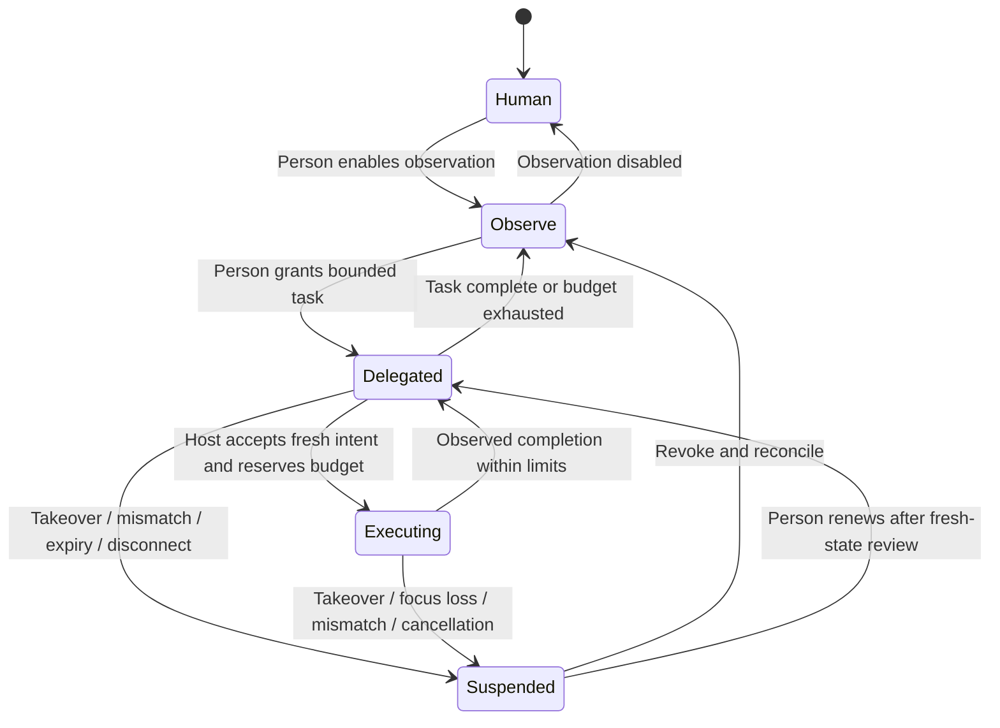

# Session authority and OS input

Status: design proposal, 2026-10-01. No actuation implementation or human-behavior
measurement exists yet. [The specification](README.md) owns the integrated design;
[runtime observation](runtime-observation.md) owns native observations.

## The shared session

The person owns one dedicated browser window, its tabs and its profile. The
agent participates visibly in that session. A session identifier names that
browser instance, not every process or window owned by the OS user. Human
navigation remains ordinary native browsing. Models receive bounded observations
and propose intents; an authority service and native executor enact an accepted
intent. The service is the only browser-role component permitted to call the OS
actuator. Untrusted page text and model outputs carry no authority.

| Mode | Observation | Model proposals | Actuation |
| --- | --- | --- | --- |
| Human | Explicitly selected observation scope | Suggestions on request | Human only |
| Observe | Named tabs/frames and approved data scope | Explanations, extraction drafts, next-step suggestions | Human only |
| Delegate | Approved observation scope | Bounded next-step intents | Host-validated OS gestures within a live grant |
| Suspended | Capture can continue within its independent scope | Existing suggestions retained and marked stale | No new gestures |

Observation, model export, OS input, network editing/sending, environmental
intervention, and table commit are separate powers. An input grant does not
authorize a traffic replay, a model upload, a fault intervention, or a DB write.
The UI exposes their scopes together so the person can see what a task actually
permits. Routine actions within a reviewed grant proceed without repeated prompts.
New destinations/effects or an exhausted limit return a useful partial result.

## Grant and intent records

These are semantic contracts, not a chosen wire encoding. IDs are host-issued
opaque references; the agent cannot turn a string into a live permission.

| Record | Required meaning |
| --- | --- |
| `Grant` | Session and grant IDs; session epoch and power-specific generation; tab and expected origin/navigation scope; task/effect description; action and time limits; cancellation conditions; approved proposal source; independent observation/export scopes |
| `ObservationRef` | Host-run/session/tab/attachment/target/frame IDs, effective origin, document and BFCache activation generations, capture start/end and coverage; node-ID generation/reference scoped to that document/session; timestamped presentation revision and uncertainty when used for input |
| `Intent` | Host-issued proposal ID and idempotency key, grant reference, observation reference, primitive and target/argument, declared effect, deadline, and completion predicate |
| `Execution` | Accepted/rejected reason; reservation; gesture start/end; event-delivery facts; post-observation; completed/failed/unknown/cancelled result; remaining grant budget |

Intents propose `point_and_click`, bounded `scroll`, `type_text`, or a named
keyboard command. Models cannot propose arbitrary JS, CDP Input events,
low-level OS events, raw trajectories, browser navigation calls, or native shell
commands through this interface. The executor computes the gesture from a
grounded target and calibrated device context. Typed text is literal data,
not a key-sequence program. Keyboard commands come from an explicit supported
set; Enter, form submission and shortcuts receive effect review just
as pointer clicks do.

The initial command set is content-focus Tab/Shift-Tab, Escape, and explicitly
authorized Enter, with native focus/recipient checks on each step. Text entry
binds a current approved content field. Browser-global shortcuts, address-bar
automation, clipboard programs and OS commands are unavailable through this
initial interface. Human URL entry is ordinary browsing; agent navigation uses
an approved content target/expected transition. Adding a native chrome command
later requires its own explicit recipient/effect contract and routing oracle.

Effects are descriptions the operator can review, not a perfect classifier.
An apparently ordinary click can submit data or spend money through hostile or
changed page behavior. Allowed destinations and task-specific effects constrain
what the host accepts, but cannot prove every script consequence. For a task
whose effects cannot be bounded sufficiently, use suggestions and human
activation. Credential entry, payment/final submission, download execution and
native dialogs require an explicitly reviewed boundary; a grant may authorize
a specific finite final submission, rather than obliging a prompt per click.

Node identity alone is insufficient for a target. Before a gesture, check current
document, frame and origin, visibility, geometry, native window identity, focus,
topmost hit target and declared effect against a fresh observation. A changed
label, occlusion, replaced document or different recipient suspends that intent.
The model can re-propose against the fresh state; it cannot reuse old authority
by replacing a timestamp. Cross-origin observation and expected navigation are
explicit parts of the grant, not implicit privileges of the top-level page.

Named-origin grants match only verified effective origins. Unknown authority
does not match any named-origin grant, and opaque/null is never a wildcard.
Optional opaque-frame consent binds the exact host surface/frame/document/
activation identity and representations; replacement/activation requires fresh
approval. Inherited about:blank/srcdoc uses verified effective-origin metadata
or the same denied/unknown policy. Pixels crossing denied frames are withheld
unless an independently reviewed enforceable screenshot scope covers them.

## Authority transitions

One host authority owner stores a session epoch and separate generations for
input, workbench, environment, table commit, observation and provider export.
A grant/operation checks both its session epoch and its relevant generation.
Changing one power does not silently rebind an old operation or revoke unrelated
powers. Global Stop and host restart invalidate effect/export grants together;
local observation can continue under its separately retained capture policy.
The state diagram below describes delegated input, not every independent power.

| Cause | Revocation and surviving work |
| --- | --- |
| Physical content takeover or native UI/editor input during delegation | Revoke input generation and pending input proposals; human workbench pauses, armed environment profile and table drafts keep their independent authority |
| Input focus loss, delivery/listening permission loss, sleep | Suspend input; sleep also processes each other power's elapsed deadline before resumption |
| Provider/bridge disconnect, change or turn cancel | Revoke proposals belonging to that instance and unsent exports; suspend its input task; human workbench/environment/table work survives |
| Frame/document/activation loss or origin transition | Invalidate affected observations, intents and context-bound network/table operations; detached diagnostics and unrelated scopes survive |
| Workbench Stop or edit-power revocation | Revoke workbench generation; reject unsent commits and resolve its pauses by stage-specific revocation disposition |
| Environment Stop or experiment expiry | Revoke environment generation; restore owned resources; workbench/input powers survive unless their own conditions fail |
| Observation/export scope reduction | Advance that policy/generation; invalidate pending affected captures/exports/derived admissions; retained local evidence follows retention policy |
| Global Stop all, host restart or session close | Invalidate effect/export grants through session epoch; cancel input/proposals/unsent exports, terminate held network work and restore environment; no autonomous renewal |

The global Stop controls Bow Shock's effects and owned interception leases. It
is not a firewall blocking all ordinary human/page traffic in the browser.
Operation-specific cancellation stays labelled so it is not mistaken for Stop all.

There is one authority owner and at most one in-flight primitive per owned
window. Accepting an intent reserves its budget before any OS event. Repeated
proposal IDs return the known result; they do not replay the gesture. An
ambiguous crash after dispatch returns `unknown`, consumes the reservation and
requires current-state reconciliation. Non-idempotent work is never retried
automatically merely because a reply was lost.

Content takeover increments the input-power generation first, rejects queued/new intents,
signals cancellation to the executor, and reports whether an event was already
posted. Resumption never continues a saved cursor path or keystroke sequence.
Provider/agent disconnect, host restart, renderer loss, permission loss, sleep,
and unexpected document/focus changes suspend affected input grants. The person must
renew after state reconciliation. Expected navigation consumes its explicit
scope and triggers a new snapshot before the next intent.

Physical keyboard/pointer activity, an always-visible stop button and a chosen
global stop shortcut are takeover signals. Synthesized events use an identified
private source where the platform supports it, so the executor does not cancel
itself. That source identifier is bookkeeping, not unforgeable human provenance.
Secure Input and event-listening failure mean takeover detection may be impaired;
delegation is unavailable while required detection is absent. A compositor's
InputCapture protocol cannot be assumed to provide passive takeover monitoring.

## Delivery and the unavoidable race

Each helper session binds a fresh host-run identity, session epoch and input
generation. An accepted primitive has a finite helper-local execution lease,
continuous-clock expiry and host-liveness requirement. The helper rejects stale
or expired commands before enqueue, retains revocation fences even for operations
it has not yet seen, and never restarts a gesture after reconnect. Only the
current bound host can renew liveness within the original finite lease.

Stop progresses through `requested`, `processed_by_helper`, and
`quiesced | recovery_uncertain`. Lost host/heartbeat invalidates the lease
locally without waiting for provider/host recovery. Native calls already in
progress remain uncertain until reconciled. A new host run cannot grant input
until the prior helper is proven terminated/quiescent, executor-owned held
state is resolved, and the measured receiver-side boundary for already-posted
events has drained. Helper termination alone cannot empty an OS event queue;
fresh DOM alone cannot establish this drain. A backend lacking a verified finite
lease/liveness/quiescence/drain contract stays
unavailable for delegation. Native measurement sets the maximum lease/liveness
interval and outstanding delivery horizon; a host timeout alone is insufficient.

macOS proposal: a small native helper owns Quartz event construction, posting
and event observation; AppKit/Accessibility supplies owned-window state where
needed. Posting, listening, Accessibility and screenshots have distinct access
requirements. Permission checks do not confer permission; prompting is part of
future runtime setup, not this research/design task.

The browser's UI shell controls which Bow Shock content surface is eligible for
delegation. Internal overlays, address bar, tabs, dialogs and workbench receive
no delegated content gesture. The executor also verifies the receiving native
window and content bounds. Prefer process-targeted delivery when the selected
OS path preserves required native semantics, subject to direct measurement.
Do not fall back silently to global posting if a scoped path fails.

Checking focus then posting is not atomic. OS queues may contain events already
posted when cancellation arrives, and process-targeting does not necessarily
bind a gesture to a particular page/window. Thus the initial design promises
**no further ordinary event enqueue after helper cancellation has been processed**,
with only the recovery-release exception below, and limits
outstanding events to a short measured delivery horizon. It does not promise
zero effects after physical takeover or atomic page-target binding. The native
capability experiment must measure that residual horizon, routing under app/tab
switch, and delivery to dialogs/other windows. If leakage cannot be bounded for
a proposed workflow, that workflow stays in human activation mode.

Never prequeue a whole gesture. Revalidate between movement segments and before
a button/key down; pair releases for executor-owned held state, under an explicit
platform recovery policy. Cancellation must stop new semantic actions, but a
release may finish an already-started action. Do not release the person's own
modifiers or blindly deliver cleanup to an unrelated window. Record held-state
uncertainty, suspend, and expose recovery when ownership cannot be resolved.

The enqueue cutoff excludes only narrowly identified recovery releases for
executor-owned downs. Those releases are recorded with their original gesture,
are never new targeting/content commands, and can themselves trigger a click or
key effect. Cancellation cannot be called `cancelled_before_effect` merely
because the final release was recovery. Where the native route cannot safely
release held state within the original receiving surface, stop and report
recovery uncertainty; do not synthesize a release into another application.

Linux proposal: Wayland RemoteDesktop portal plus libei/EIS on a verified
compositor/backend; X11 XTEST is a separately labelled capability. Portal
association with a parent window is not a confinement guarantee. uinput has
broader seat/device authority and is a separately discussed fallback, never an
automatic escalation. If delivery or human-takeover coverage is unsupported,
the session supports observation and suggestions, not delegated input.

## Adaptive gesture generation

The target is useful human-compatible interaction, not a claim that software
input is physically human. Device/display/scale, keyboard layout/IME, pointer
transfer path, target geometry, task and observed page latency are conditioning
variables. The person can inspect and select the behavior profile.

Pointing uses a goal-directed trajectory with correlated velocity/timing
variation and corrective observation, constrained to the visible target and
delegation region. Fitts-style movement-time relations and minimum-jerk models
are candidate starting points, not a ready-made human distribution. Wheel bursts
and trackpad momentum have separate models with bounded direction/distance and
observed nested scroll targets. Typing accounts for literal text, composition
and actual platform outcomes. Operator update 2026-10-16: error and correction
behavior must be grounded in human data, including conditional mistaken-key
likelihoods; the previous blanket exclusion of modeled typos is superseded.
Use the [empirical-input plan](../plan/empirical-input.md), with browser-observed
event sequences and intermediate effects rather than only a final value. Waiting
follows page/task state and a deadline, rather than random sleeping across errors.

Noise must not widen authority, cross a forbidden surface, defeat cancellation,
change submitted content, or conceal an unknown outcome. Network fault schedules
are a separate environmental control and are never smuggled into gesture timing.
Calibration is opt-in and scoped to ordinary browsing in the owned window;
secure/password fields and content of private keystrokes are excluded. Retain
derived motion features within a stated retention scope rather than a general
desktop keylogger.

Evaluate complete held-out task/device-conditioned sequences against reviewed
human sessions: movement time/geometry, velocity and corrections, click outcomes,
scroll bursts/reading context, action order and task success. Measure false
cancellation, interruption latency and operator correction effort alongside
behavioral statistics. `isTrusted` and a plausible cursor trace alone cannot
establish human similarity, site acceptance, or privacy.

## Direct falsification scenarios

| Scenario | Required outcome/evidence |
| --- | --- |
| Old node survives a navigation or frame replacement | Old intent rejected by document epoch; no gesture starts |
| Human moves pointer during motion | Input generation revoked; no ordinary enqueue after helper cancellation; recovery releases and already-posted horizon measured at receiver |
| Window/tab/dialog switches between check and dispatch | Trace actual receiver and semantic outcome; incompatible routing disables delegation for that capability |
| Renderer/model/host dies after mouse down | Held-state facts and unknown result preserved; no automatic click/retry; recovery does not touch unrelated windows |
| Model repeats accepted intent after reconnect | Existing execution returned; no duplicate receiver-side action |
| Target moves or is occluded mid-gesture | Cancel/re-observe; noise cannot retarget to a new action |
| IME/Secure Input/listening access changes | Suspend, report capability loss; no silent keyboard fallback |
| Page changes an ordinary link to a consequential action | Surface limits of effect review; workflow requires human activation where effects cannot be bounded |

Source basis: [native input research](../../papers/os-input-and-behavior.md),
[native browser surfaces](../../papers/native-browser-surfaces.md),
[tandem systems and browser-agent security](../../papers/tandem-browsing.md).
Primary references include [Quartz posting](https://developer.apple.com/documentation/coregraphics/cgevent/post(tap:)),
[libei](https://libinput.pages.freedesktop.org/libei/),
[the RemoteDesktop portal](https://flatpak.github.io/xdg-desktop-portal/docs/doc-org.freedesktop.portal.RemoteDesktop.html),
[MacKenzie](https://www.yorku.ca/mack/hci1992.html),
and [optimal feedback control](https://doi.org/10.1038/nn963).
