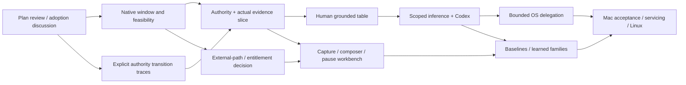

# Implementation plan

2026-10-01. This plan implements the [reviewed design](../design/README.md),
including its [16 integrated tribunal dispositions](../../papers/design-tribunal.md).
It is a proposed execution sequence, not evidence of a working browser. Plan
review is recorded in [the plan tribunal](../../papers/plan-tribunal.md).

The operator's subsequent [Rust-basics direction](rust-basics.md) establishes
the pinned hygiene/test/dependency gates and defers deterministic simulation,
mutation runs and heavier proof/model-checking tools for the POC. Direct failure
tests and independent review remain required. The first implemented unit is
bounded controller pipe framing; native runtime capabilities remain unearned.

The first useful outcome is a dedicated macOS window that the person can browse
normally, inspect through native observations, and use to review a small grounded
table. Native feasibility experiments run alongside that path. Automation is
enabled only after authority and actual delivery gates pass. The full roadmap
keeps request/response craftsmanship, external faults, baselines, adaptive input,
native agent collaboration and learned page patterns in scope.

## Execution units and owners

| Lane | Work and detailed sequence |
| --- | --- |
| Native runtime | [Owned CEF window, observation and native-input feasibility](native-runtime.md) |
| Effect admission and local evidence | [Shared authority and conformance](authority-conformance.md) |
| Network | [Capture, workbench, external environment and baselines](network-roadmap.md) |
| Agent and extraction | [Provider bridge, grounded fields and tandem task](agent-and-extraction.md) |

One owner integrates the controller authority across powers; no lane implements a
second grant manager. Independent native/data/endpoint oracles attack different
fault classes. A conceptual task owns its red oracle, implementation, green
results and code review. Integration starts when usable contracts exist, not
after every lane finishes a large private subsystem.

## Proposed adoption and repository shape

The dependency proposal is deliberately small. Adoption is discussed with the
operator before implementation, as required by [AGENTS.md](../../AGENTS.md).
The concrete proposal and failure alternatives below are that discussion's
basis; reference acquisition has not adopted anything.

| Candidate | Intended use | Boundary / alternative |
| --- | --- | --- |
| Matching stable macOS ARM64 CEF standard distribution | Browser runtime, native local inspector and first diagnostic HTTP adapter | Acquire from the upstream-linked build service with its matching headers/wrapper/framework/helpers; exact tuple and supported API belong in a tracked runtime manifest. Qt WebEngine is a separately reviewed fallback if the CEF viability gate fails. |
| Installed Clang/CMake and AppKit/Quartz | Small Objective-C++ engine shell/native input helper and normal macOS controls | Start from studied packaging patterns; no copied reference app or broad automation framework. Swift is available but an extra helper language is unnecessary initially. |
| Rust controller plus serde/serde_json | Typed authority, bounded native/agent IPC and evidence coordination | Explicitly sized JSONL envelopes initially, no generic RPC forwarder or async-framework dependency by default. Closed payloads, bounded queues and generation identity are part of admission. |
| SQLite through a narrow Rust adapter such as rusqlite | Real evidence/row transactions and lifecycle reconciliation | Proposed bundled matching SQLite for reproducible semantics, subject to adoption; system SQLite is a separately recorded alternative. SQL schemas and transactions are application-owned. |
| Installed Codex App Server | Trusted coding-agent conversation over owned stdio | Start with the inspected 0.160.0 schema, verify version/capabilities at connection; no SDK or generic command exposure. It remains a trusted peer when it has ambient shell. |
| Existing workspace Jev tool | Small nonprivate advisory evaluation before any product SDK choice | Do not copy parent credentials. Product inference transport/provider and local inference runtime remain separate adoption decisions. |

Primary package documentation currently exposes candidate `serde 1.0.229`,
`serde_json 1.0.151` and `rusqlite 0.40.2`; use the Serde derive feature and
rusqlite bundled-SQLite feature only as needed. These are proposal versions,
not a resolved/transitively audited lockfile. Recheck and lock the actual graph
at adoption. [Serde](https://docs.rs/crate/serde/1.0.229),
[serde_json](https://docs.rs/crate/serde_json/1.0.151),
[rusqlite bundled build documentation](https://docs.rs/crate/rusqlite/0.40.2).

Production dependencies get exact revisions/features in their native lockfiles
and a compact runtime/dependency manifest when adopted. Preserve downloaded
engine archives and source origins; generated build output and engine binaries
remain ignored. Nothing from quarantine is copied into a shipping source tree.
Building the upstream engine distribution is different from executing acquired
reference projects; third-party examples remain study material.

Proposed source layout after plan review/adoption:

```text
native/cef/          Objective-C++ engine shell and fixed native operation adapter
native/input/        macOS executor, local expiry/stop and receiver probes
native/network/      capability-specific native environment adapters, when viable
crates/authority/    typed admission, per-power generations and operation state
crates/evidence/     SQLite/blobs, staging/commit/deletion and event views
crates/bridge/       provider/Codex framing, disclosure and proposal validation
crates/network/      exchange, workbench and environmental-operation state
fixtures/           owned pages, endpoints, native receivers and expected outcomes
tests/              contract traces and integration drivers with direct oracles
docs/experiments/   candidate build/capability results and measured limits
```

This is a proposed layout, not a command to create empty crates/frameworks now.
Begin with the minimum modules necessary for each vertical slice. Shared domain
types have one owner; protocol method allowlists stay explicit at the adapter.

## Milestones and dependencies

| Milestone | Concrete task/output | Depends on | Exit / branch |
| --- | --- | --- | --- |
| P0 — reviewed plan and adoption discussion | Resolved plan findings, concrete engine/tool/library proposal, current host and exact distribution metadata | Reviewed design | Discuss adoption before download/build/runtime code; unknown choices do not become implicit defaults |
| P1 — owned runtime and early feasibility | Matched macOS window/profile/process packaging; ordinary manual browsing; owned receiver/endpoint; fixture native reader, control-only helper and capture-work gate; early external-path decision | P0; minimal control records shared with A1/A2 | Sandbox/lifecycle and honest coverage; general human reader only after N3 capture-work passes. No OS posting in P1; no sandbox fallback. |
| P2 — authority and evidence through one slice | Typed shared generations/fences; real SQLite events/commit/deletion; fixed native command channel; lifecycle denial on restart | P1 native identities; pure transition work can start after P0 in parallel | Original tribunal traces satisfy production effect/DB oracles; uncertainty and failure remain visible |
| P3 — human observation/table work | Native source highlights, six field states, reviewed exact batch commit and retention; useful partial results after takeover | P1 N3 capture-work-qualified observation + P2 | First end-to-end human workflow works with a deterministic candidate selector; no model required to prove capture/commit |
| P4 — scoped model and Codex connection | Bounded provider contract, actual export capture oracle, typed candidates, generation/callback/history rules; trusted-peer role shown | P2; P3 provides a useful candidate task | Late/duplicate/malformed output produces zero unauthorized effect; installed-version stdio integration passes. Provider placement/export scope is explicit. |
| P5 — bounded OS delegation and calibration | Verified native delivery, stop/liveness/drain and current-target checks; then adaptive pointing/scroll/typing profile | P1 native probe + P2 + P4 | Receiver-side semantic outcomes and measured race horizon; unsupported workflows remain human activation. Behavioral similarity is evaluated separately. |
| P6 — network workbench and outside-browser experiments | Passive coverage then isolated composer, stage-specific pauses/edits, finite fault profiles with owned recovery | P1 coverage + P2; early topology/entitlement decision begins in P1 | Exact browser/server bytes and effects; bounded body teardown before body editing; actual outside-browser packet/path experiment or explicit unresolved deployment decision |
| P7 — learned families and traffic baselines | Positive/negative page teaching, holdout drift cases; comparable traffic samples, concrete deltas and optional Jev interpretation | P3/P4 for patterns; P6 capture for baselines | Grounded rows, no unchecked writes; expected retries cannot hide disclosure; coverage mismatch remains inconclusive |
| P8 — complete macOS acceptance, then Linux port | Required workflow join below, whole failure runs and engine servicing; subsequently repeat contracts on named Linux stack | All named core capabilities, including N7 existing-body edit and N8 packet/path cases | Every required actual workflow passes or an explicit scope/design amendment exists. Missing required capability is partial/blocked, never full acceptance. |

P6 is a sequence, not a single giant task: [the network lane](network-roadmap.md)
gives its separate admissions and gates. Its macOS confinement decision is made
in P1 so a late discovery cannot hollow out the product. P5's native feasibility
likewise begins early; production delegation waits for authority and actual
recovery. P7 may run nonprivate model-selection experiments without promoting
them into runtime capabilities.

Milestone labels are joins of subtasks, not whole-phase barriers. In particular,
N1 supplies initial native identities, A1/A2 establish the minimal nonblocking
control records/owner, N2a starts its control-only helper, and N3 qualifies capture
before P1/P3 promote the reader. A3/A4 persistent tables follow those identities;
N4 posting follows minimal A2 and N3. This removes a P1/P2 bootstrap cycle without
requiring the whole evidence subsystem before independent Stop tests.



## First native sub-plan

After review and adoption discussion, acquire one matching standard CEF archive
into an ignored engine-artifact store and record origin/version/digest/restoration.
Build an application-owned smallest native shell with a fresh disposable profile.
Human browsing and shutdown are the first runtime outcomes. The owned fixtures
then establish native capture/lifetime/geometry and request coverage against
their known markers/bytes, without provider access or page control commands.

The native-input receiver exists before actuation. Its expected event/action
records must fail when input reaches a wrong window, repeats or continues past
the permitted cutoff. P1 constructs a control-only helper before capture overload
tests, with no OS posting/listening. Only after minimal A2 authority and native
N1–N3 gates does N4 add one human-armed finite fixture primitive plus local
stop/expiry. Verify routing and held-state/drain recovery before model-connected
delegation. In parallel, decide the attainable confined external
network mechanism and deployment. Unavailable features stay disabled rather
than exposing host-global controls to complete a demo.

If the CEF window's sandbox, process/identity or lifecycle cannot satisfy the
design, stop extending that adapter and compare the named fallback against the
same owned oracles. If OOPIF/AX or large-page capture is partial, ship the honest
partial human reader while prohibiting dependent actions; never disable site
isolation to fabricate full coverage. Native execution findings can require a
design amendment and review before implementation continues in that lane.

## Acceptance strategy and working discipline

Complete macOS acceptance joins these actual workflows on the selected build:

- Dedicated native browsing, sandbox/lifecycle/servicing and a capture-work-
  qualified DOM/AX projection with origin/freshness/coverage and scoped export.
- A live selected inference adapter plus native Codex conversation, correctly
  labelled roles/history, with late/invalid proposals producing no unauthorized
  effects. Dynamic tools are optional; model placement is explicit.
- A bounded tandem task with at least one supported keyboard, mouse and wheel
  case in declared device/display conditions; measured takeover/lease/drain;
  adaptive behavior evaluated against held-out complete human sequences using
  criteria chosen before tuning, with task/correction cost included.
- Human request composition/edit, finite **existing** response-body/header/status
  edit (network N7), exact peer/page evidence and destructive-boundary teardown.
  Known synthetic fulfillment alone does not satisfy existing-body editing.
- A confined outside-browser packet-delivery fault **and** a native owned path/
  link/route transition (N8), with independent control, real OS/Chromium/page/peer
  evidence and owned cleanup. Offline events are measured, not promised.
- Reviewed comparable traffic baselines with expected retries plus independent
  disclosure changes, including incomplete-coverage outcomes; a taught page
  family with held-out/drift cases and exact reviewed DB commits/deletion.

Partial milestones stay useful and labelled partial. Failed N7/N8 or behavior/
native gates trigger a concrete adapter/topology/criteria sub-plan and review,
or an explicit operator-reviewed scope amendment. An unresolved deployment
decision or honest unsupported matrix cannot satisfy this full-scope join.

Following the operator's Rust-basics direction, deterministic simulation and
mutation runs are deferred for the current POC. Use explicit expected transition
traces and actual adapter/store/transport outcomes for each construction unit.
The following deeper methods remain future escalation guidance:

Use one small executable authority/lifecycle model where transitions have a
useful reference interpretation. Enumerate/reorder actual failure events and
compare production admission state; do not build a general simulator or formal
toolchain as a prerequisite to the first window. Model/property/fuzz evidence
does not certify OS routing, server receipt, SQLite durability or provider bytes:
each has its own direct receiver/store/transport oracle in the lane plans.

Owned fixtures have known initial state and independent expected results.
Check mutations of critical deny/epoch/identity paths only when they add evidence,
and run any mutants on an operator-available fleet, never this laptop. If no
fleet exists, record that form as deferred and retain direct falsification cases;
do not start a local mutation run. A headless CI job cannot certify macOS focus,
input permission, event queues or actual OS path changes.

Each implementation unit follows Blackbird: written sub-plan, meaningful red
oracle, source-grounded implementation, green result, independent code review,
then integration of findings. The first useful slice receives a review before
the next subsystem broadens powers. No redundant receipt hierarchy or blanket
“coverage passed” closes a capability. Evidence records exact build, observed
limits and unsupported operations so later work knows what was learned.

Define behavior/compatibility measures before comparing candidate gestures:
held-out complete human task/device sequences, target success, action ordering,
takeover latency, false cancellation, review/correction time and disclosure
effects. Inspect normal engine defaults and observation overhead against a
same-platform/build ordinary browser. Do not infer site acceptance from
`isTrusted` or privacy from one noisy path trace. Pilot tasks use owned pages;
later ordinary-site human sessions are limited to the reviewed task and data
scope, without production payments or repeated irreversible fixture actions.

## Decisions exposed to the operator

Recommended first adoption is the matched CEF/AppKit/CMake runtime plus the
small Rust/JSON/SQLite controller boundary. No browser binding framework, automation
framework, TLS interception CA, system packet filter, model SDK or VM is bundled
into that decision. Codex initially remains a trusted coding peer; an inference-
only provider can serve the constrained browser role. A local-only provider
requirement can change P4's adapter without rewriting authority.

The macOS external packet/path branch may require signed entitlements, an owned
external route or a separately reviewed guest deployment. An actual deployment
change has implications for native input, fingerprint and window ownership;
it is returned as a concrete design decision, not a silent fallback. The initial
workflow is the reviewed page/table task; tracker investigation remains a full
parallel product requirement.

Dates and effort estimates are intentionally absent until the first native
gates establish the actual feasible mechanisms. Task exits and dependencies are
concrete; uncertainty cannot be converted into a deadline promise.
