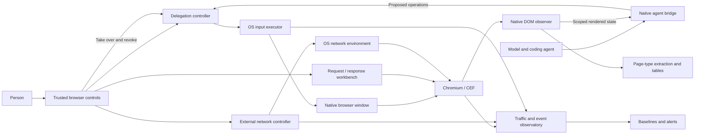

# Bow Shock: research synthesis

Prepared 2026-10-01. The operator's direction is a **dedicated browser window,
macOS first, Linux second**, with human-agent tandem browsing, deliberate limits
on automation, and a native connection to an agent such as Codex.

The [product brief](product-intent.md) captures subsequent requirements:
native rendered DOM observation; OS keyboard/mouse/scroll execution;
request/response inspection and editing; externally simulated network
interruptions; traffic baselines and alerts; and learned DOM-to-table extraction.
The model proposes work and does not directly drive page APIs.

The repository now contains a broad primary-source corpus and reference-code
collection. This is a research foundation. It does not select dependencies,
declare a final browser design, or claim an exhaustive literature review.

## Direction supported by the evidence

CEF is the leading engine to investigate for this scope. It gives the host
ownership of browser windows and lifecycle, exposes browser-side callbacks, and
supports asynchronous in-process DevTools calls without an exposed debugging
listener. Its macOS helper/sandbox arrangement needs current-version study.
Qt WebEngine is the main comparison; Electron/Min provide shell patterns to
study, and WebKit-based alternatives provide an independent engine comparison.
A full Chromium fork would add substantial product/build/update ownership before
the tandem interaction is understood. This prioritization is our inference.
[Native browser study](../papers/native-browser-surfaces.md),
[broader engine survey](../papers/browser-engines.md),
[CEF interface](https://github.com/chromiumembedded/cef/blob/master/include/cef_browser.h).

Keep extension/native-host references for interaction and permission ideas.
Chrome's temporary `activeTab` grant and the acquired Chromium connection-approval
code are useful precedents. An approved debugging connection still grants broad
instrumentation; it does not enforce a particular task boundary.

## What semi-automatic should mean

The person can browse normally, ask for analysis, request a proposed action,
delegate a bounded sequence, interrupt it locally, do a manual subtask, and
resume with fresh state. Those modes need distinct authority. Suggestions and
human decisions should remain visible in browser chrome. Partial completion can
be useful: compare options, prepare a draft, fill selected fields, or ask the
person to handle an ambiguous step.

CoScripter already represented manual steps; MIWA provides inspection, stepping,
and correction; CowPilot explores interleaved human/agent actions. CowPilot's
countdown executes unless vetoed, and its small authors-only study does not
establish general-user efficacy. Use these systems to formulate experiments,
not to inherit their authorization rules.
[Tandem review](../papers/tandem-browsing.md),
[historical systems](../papers/browser-predecessors.md).

## Separate conversation from browser authority

There are two useful connection directions: Bow Shock can be a client of Codex
App Server, or it can expose constrained tools to an existing Codex client over
MCP. App Server supports conversation and event integration; browser permission
belongs to our host in either direction. Protocol support and experimental
features must be checked against the installed version before implementation.
[Connection survey](../papers/agent-connections.md),
[official App Server documentation](https://learn.chatgpt.com/docs/app-server).

The following is a candidate decomposition for review, not an implementation:

The controller needs to cover every model-exposed actuation route. Arbitrary
JavaScript, raw CDP, retries, and secondary connections can otherwise bypass a
policy placed only on named click/submit tools. Bind queued actions to their
observed document and grant. Human takeover must revoke locally before asking
the agent to cancel; it cannot undo a transaction already dispatched.

For the operator's stated architecture, model observation can use native DOM,
layout, and accessibility without exposing `Runtime.evaluate`, protocol input,
or DOM mutation tools. Page interaction goes through OS events. Network editing
is a separate explicit human workbench. The environment controller operates
outside the browser; browser-level offline emulation alone does not meet that
requirement. Input realism and the privacy effect of network perturbations need
separate measurements.

Reading is also a power: authenticated text, screenshots, frames, summaries, and
memory can carry information between origins and into the agent runtime. The
same-origin browser literature and CaMeL motivate provenance and data-flow
questions. ceLLMate's request enforcement is worth studying, but its sole-agent
and dedicated-session assumptions do not establish tandem safety.
[Security evidence and limitations](../papers/tandem-browsing.md).

## Next decisions and their direct evidence

1. Define representative user tasks and the boundary between proposing,
   delegating, and manually completing them. Select useful assistance outcomes
   before selecting an automation budget.
2. Read CEF's helper, sandbox, native window, DevTools observer, and frame/router
   lifecycle code alongside Qt's corresponding interfaces. Decide language and
   runtime servicing after that comparison; dependency adoption requires the
   operator discussion specified in the workspace instructions.
3. Specify grant scope, stale-state handling, pending-action ownership, and
   local takeover behavior. Review adversarial traces: navigation during model
   thought, changed recipients, delayed tool results, popups, frame replacement,
   and ambiguous completion after a disconnect.
4. Design controlled evaluations with instrumented sites. Compare manual
   browsing, individual proposals, and bounded delegation. Check actual final
   state and prohibited effects, and measure human monitoring/correction time.
   A successful tool call or a lower click count is insufficient evidence.
   Observe actual OS-delivered input, focus/takeover failures, request/response
   edits, baseline false alarms, external interruption effects, and extracted
   field/row correctness as distinct claims.
5. Pressure-test that specification, then write an implementation plan and
   review it before product code, following Blackbird.

Open work is tracked in [ISSUES.md](../ISSUES.md). Acquisition gaps and deferred
datasets are in [SHOPPING_LIST.md](../SHOPPING_LIST.md).

## Expanded network source study

The operator requested a substantial network-tool quarantine. The
[network reading map](../papers/network-quarantine.md) groups the additional
proxy/protocol, capture/environment, tracker/logging, archive/replay and
controlled-endpoint references. Source findings reinforce the need to measure
capture coverage, intervention scope and cleanup before relying on a tool.

The existing workspace Jev client is also available. A
[12-case constructed pilot](../papers/jev-network-judgments.md) exercised
advisory interpretation of traffic differences in one batched call. It matched
the intended labels, including coverage gaps and mixed retry/contact-field
changes. The proposed role is semantic assistance after deterministic capture,
normalization and provenance; permissions and execution remain host-owned.
