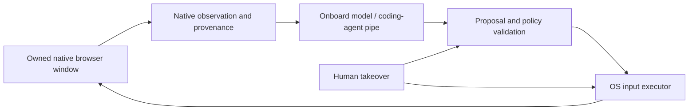

# Native rendered-page observation and browser identity

Research date: 2026-10-01. Scope: an owned browser window, macOS first and Linux second; native observation for an onboard model and a pipe to a coding agent; the model never directly drives the page. A separate executor owns actual OS keyboard, mouse and scroll effects. Network perturbations, if designed later, occur outside the browser; this report studies browser observation and identity and makes no host-network changes. This is research, not engine adoption or product implementation.

Sources are cataloged in [native-browser-sources.json](native-browser-sources.json). Chromium and CEF conclusions below cite actual acquired revisions, not just current API prose. Runtime/browser builds and exact platform behavior remain untested.

## What is feasible without model-authored JavaScript

CEF supplies genuine native DOM traversal. Chromium also implements DOMSnapshot, DOM geometry/hit-testing and accessibility commands in native Blink code. CEF's local DevTools API can reach these through native structured method calls without opening a remote-debug socket and without executing a JavaScript extractor. Thus native observation is feasible without granting `Runtime.evaluate`, DOM mutation or protocol input commands to either model. [Pinned CEF browser interface](https://github.com/chromiumembedded/cef/blob/ff57d4eae16d36457895f2de115a71d502e85a08/include/cef_browser.h), [Pinned Blink snapshot implementation](https://github.com/chromium/chromium/blob/faee0a28a27e62768c53844d7a29a63d609315dd/third_party/blink/renderer/core/inspector/inspector_dom_snapshot_agent.cc)

However, **native DOM is not identical to the rendered page**. A full DOM contains hidden nodes and form values; a layout tree includes objects outside the viewport; an accessibility tree has a different semantic projection; actual pixels can contain canvas, video, generated content and compositor effects. A useful rendered-page representation must join these views and retain their limits rather than label raw markup “what the human sees.” This conclusion follows directly from the native snapshot schema and implementation. [Pinned DOMSnapshot schema](https://github.com/ChromeDevTools/devtools-protocol/blob/8b7f1d955017db8633ecae04cdfa194f731c9eff/pdl/domains/DOMSnapshot.pdl)

The current evidence favors studying **native windowed CEF + local native snapshot/AX observation** as a focused owned-window candidate. Direct CefDOMVisitor is a simpler alternative or supplement, but its API and implementation do not establish a complete rendered-state map. This is a research prioritization; no binary was installed or dependency selected.

## CEF DOM visitor: real native access, strict lifetime

The pinned `CefDOMVisitor` contract says its methods run on the renderer main thread, and document/node objects are valid only inside `Visit`. `CefFrame::VisitDOM` is renderer-process-only. In `CefFrameImpl::VisitDOM`, CEF constructs a native `CefDOMDocumentImpl`, invokes the visitor and immediately calls `Detach()`. The implementation invalidates its frame pointer and detaches retained nodes; debug assertions reject handles retained beyond the callback. [DOM visitor contract](https://github.com/chromiumembedded/cef/blob/ff57d4eae16d36457895f2de115a71d502e85a08/include/cef_dom.h), [Renderer implementation](https://github.com/chromiumembedded/cef/blob/ff57d4eae16d36457895f2de115a71d502e85a08/libcef/renderer/frame_impl.cc), [Document detach](https://github.com/chromiumembedded/cef/blob/ff57d4eae16d36457895f2de115a71d502e85a08/libcef/renderer/dom_document_impl.cc)

Consequences for an onboard model are concrete. Copy permitted primitive data into an owned representation during the callback, release all CEF DOM handles before returning, and send that data asynchronously to the browser/native observation broker. Model inference cannot hold the visitor open or keep live DOM objects. Putting an entire LLM runtime in the renderer solely to use this API would couple inference to the sandboxed rendering process and its lifetime; that is not required for native extraction. These are design implications, not an implementation performed here.

The visitor exposes document root/body/title/selection/focus, node traversal and attributes, form-control type/value, and element bounds. Two implementation details prevent treating it as an already-correct rendered observer:

- `CefDOMNodeImpl::GetElementInnerText()` calls Blink `WebElement::TextContent()`. The method name should not be read as evidence that hidden text, viewport clipping or paint visibility has been resolved.
- `GetElementBounds()` calls `BoundsInWidget()`. The public header describes device pixels. Mapping those widget coordinates through iframe placement, page zoom, backing scale and the actual screen/window needs explicit verification; a rectangle is not proof of clickability or visibility.

`GetValue()` extracts form-control values and trims leading whitespace. It therefore cannot be assumed to preserve the exact raw field representation, and field contents may include sensitive text. [Pinned native node implementation](https://github.com/chromiumembedded/cef/blob/ff57d4eae16d36457895f2de115a71d502e85a08/libcef/renderer/dom_node_impl.cc)

The exposed DOM API also contains mutators. A native observer must expose its own restricted data interface, not hand the model `CefDOMNode`, a generic command dispatcher, or a bridge to setters. Native access does not by itself separate observation from actuation.

## Native DOMSnapshot: rendering-aware extraction

In the pinned Blink implementation, `InspectorDOMSnapshotAgent::captureSnapshot` first updates the root view lifecycle through compositing inputs, then visits documents and nodes in C++. It collects nodes, attributes, layout bounds, computed styles, inline text boxes, scroll offsets and optional paint order. It does not require a page-JavaScript extractor. The layout update also means observation is work inside the renderer, not a zero-cost external peek. Snapshot frequency/size and effects on responsiveness require measurement. [Pinned snapshot implementation](https://github.com/chromium/chromium/blob/faee0a28a27e62768c53844d7a29a63d609315dd/third_party/blink/renderer/core/inspector/inspector_dom_snapshot_agent.cc)

The schema connects node-table indices to layout nodes and supplies backend DOM node IDs, frame IDs, document URLs, text fragments, computed-style selections and paint order. Shadow DOM is flattened. The implementation explicitly loops `LocalFrame` entries and links content documents present in that local document map. Therefore do not interpret one renderer snapshot as a globally synchronized snapshot across all site-isolated frames. OOPIFs require target/session routing and aggregation; frames can navigate between captures. [Snapshot schema](https://github.com/ChromeDevTools/devtools-protocol/blob/8b7f1d955017db8633ecae04cdfa194f731c9eff/pdl/domains/DOMSnapshot.pdl), [Target schema](https://github.com/ChromeDevTools/devtools-protocol/blob/8b7f1d955017db8633ecae04cdfa194f731c9eff/pdl/domains/Target.pdl)

Raw snapshot data requires native policy filtering before either model receives it. Blink's implementation copies input values for input elements without a password-type check in that extraction branch. The snapshot also includes nodes without a corresponding visible layout object. A rendered-only view and a separately authorized full-DOM view must not be silently conflated. This is data minimization needed by the stated product meaning, not an assumption that snapshot data is safe because native code produced it.

A plausible research representation would distinguish:

| Layer | What native data contributes | What remains unresolved |
| --- | --- | --- |
| DOM structure | Frame/document provenance, elements, relationships, node IDs | Hidden and sensitive content; no inherent visibility guarantee |
| Layout/style | Geometry, text fragments, clipping-related styles, stacking/paint ordering | Occlusion, transforms, compositor effects and viewport mapping |
| Accessibility | Roles, names, state and relationships linked to backend DOM IDs | Missing/custom semantics; ignored nodes; frame coverage |
| Pixels | Current visual content including canvas/media/custom drawing | Structure/meaning; snapshot time and window occlusion |
| Native hit test | Node/frame at a current coordinate | Races between observation, validation and an OS event |

DOM's native `getNodeForLocation` returns backend-node and frame identifiers. `getBoxModel`/`getContentQuads` offer further geometry. The protocol also contains mutators alongside these readers. A broker should have an explicit reader allowlist and fixed native request construction. Granting “the DOM domain” is too broad for the requirement that the model never drive the page. [Pinned DOM schema](https://github.com/ChromeDevTools/devtools-protocol/blob/8b7f1d955017db8633ecae04cdfa194f731c9eff/pdl/domains/DOM.pdl)

## Accessibility is a complement, with a windowed CEF distinction

CEF's browser header distinguishes windowed Complete accessibility mode, where Chromium supplies platform accessibility objects, from windowless TreeOnly mode, where `CefAccessibilityHandler` receives tree/location updates but the embedder must provide platform objects. Do not assume the callback designed for offscreen integration is the normal windowed AX observation route. For the owned-window requirement, local CDP Accessibility and the native platform AX surface are separate candidates. [Pinned CEF accessibility behavior](https://github.com/chromiumembedded/cef/blob/ff57d4eae16d36457895f2de115a71d502e85a08/include/cef_browser.h), [Accessibility handler](https://github.com/chromiumembedded/cef/blob/ff57d4eae16d36457895f2de115a71d502e85a08/include/cef_accessibility_handler.h)

The pinned CDP Accessibility schema carries names/roles/state, ignored-node information and optional backend DOM node IDs. `getFullAXTree` accepts a frame ID. Several APIs are marked experimental, so runtime support cannot be inferred from a newer protocol checkout. CEF also has an experimental viewport-collapse option: it summarizes offscreen content and disables CDP dynamic `nodesUpdated` events while leaving platform screen readers on their separate path. It is not a free default simplification for an observer that relies on incremental updates. [Pinned Accessibility schema](https://github.com/ChromeDevTools/devtools-protocol/blob/8b7f1d955017db8633ecae04cdfa194f731c9eff/pdl/domains/Accessibility.pdl), [CEF experimental AX option](https://github.com/chromiumembedded/cef/blob/ff57d4eae16d36457895f2de115a71d502e85a08/include/cef_browser.h)

## Stale documents and coordinates are an authority problem

CEF frame lifecycle callbacks explicitly cover detach/reattach around BackForwardCache, connection failures, destruction, cross-origin navigation and renderer termination. A retained frame object or `IsValid()` result is not proof that it still describes the same active document. The protocol's `DOM.documentUpdated` explicitly invalidates node IDs. Backend IDs are useful joins within live context, not permanent task identifiers. [Pinned frame lifecycle](https://github.com/chromiumembedded/cef/blob/ff57d4eae16d36457895f2de115a71d502e85a08/include/cef_frame_handler.h), [Pinned DOM invalidation contract](https://github.com/ChromeDevTools/devtools-protocol/blob/8b7f1d955017db8633ecae04cdfa194f731c9eff/pdl/domains/DOM.pdl)

Observation records should therefore retain browser/window identity, target/session, frame, document/navigation generation, origin, capture interval, viewport/zoom/scale and node/AX join provenance. A stale result should be discarded or explicitly marked stale. Native rendering updates, human input, popup creation and scroll can change targets without waiting for model inference. Before an executor effects an approved intent, it must check that its observed target and geometry still apply and that the human has not reclaimed control. This is a design inference from the documented lifetime mechanisms; no cross-process atomic snapshot or OS-event atomicity is claimed.

## Separation of model observation and OS execution

The operator's rule is stronger than “the model usually uses a safe tool.” It requires a structural boundary: both the onboard LLM and coding agent consume bounded observation records and return proposals; native policy validates those proposals; only the executor can translate an accepted proposal into OS effects. The coding-agent pipe is not a pass-through to CDP, CEF setters or an OS input handle.

This is a proposed research boundary, not a hardened design. It excludes model-accessible `Runtime.evaluate`, DOM setters, `Input.dispatch*`, direct navigation, cookie mutation and arbitrary method strings from the observation channel. The user's actual-OS-input requirement is separate from CEF's `SendKeyEvent`/mouse/wheel APIs and CDP input injection; those APIs exist but do not establish that the OS event path was used.

## Network observation is different from external interruption

CEF native resource callbacks expose request/response metadata, redirects, completion and response filtering. Most run on the IO thread. Browser/frame pointers may be absent for service-worker requests or `CefURLRequest`; completion can arrive after browser closure. A trustworthy observer must account for missing provenance and thread/lifetime constraints instead of attributing every request to the currently visible page. [Pinned resource-request handler](https://github.com/chromiumembedded/cef/blob/ff57d4eae16d36457895f2de115a71d502e85a08/include/cef_resource_request_handler.h)

CDP Network supplies a second observation surface with requests, responses, failures, timing, cache/service-worker information and optional bodies. It also includes powerful setters, cookie operations, request replay and network emulation. Read access should be constrained separately, and network bodies/cookies should not automatically enter model context. These interfaces can observe an externally caused interruption; they do not make a CDP emulation command equivalent to an actual OS network event. The external-network lane owns that distinction. [Pinned Network schema](https://github.com/ChromeDevTools/devtools-protocol/blob/8b7f1d955017db8633ecae04cdfa194f731c9eff/pdl/domains/Network.pdl)

## Ordinary browser identity means a coherent runtime

A native owned window avoids having to build the product around a headless-only surface, but it does not establish Google Chrome equivalence. CEF uses Chromium and can expose Chrome-style product UI; that does not make the build, bundled features, services or platform integration identical to a shipping branded browser. Chromium's own Linux comparison calls out differing codec packages, API keys, testing, sandbox/packaging and vendor additions; it is Linux-specific evidence, not a complete macOS checklist. [CEF architecture](https://github.com/chromiumembedded/cef/blob/ff57d4eae16d36457895f2de115a71d502e85a08/docs/architecture.md), [Pinned Chromium/Chrome comparison](https://github.com/chromium/chromium/blob/faee0a28a27e62768c53844d7a29a63d609315dd/docs/chromium_browser_vs_google_chrome.md)

CEF settings allow a full User-Agent override or product token. Chromium generates Client Hints separately, including brand lists, platform, architecture and version. In the acquired `GetUserAgentMetadata`, a command-line UA override leads to blank metadata or only low-entropy defaults depending on a feature flag; the code itself notes possible firewall rejection for empty hints. Therefore changing one header is not evidence of an ordinary coherent fingerprint, and can harm compatibility. Study the actual windowed runtime's native defaults first. [CEF settings](https://github.com/chromiumembedded/cef/blob/ff57d4eae16d36457895f2de115a71d502e85a08/include/internal/cef_types.h), [Pinned UA/Client Hint generation](https://github.com/chromium/chromium/blob/faee0a28a27e62768c53844d7a29a63d609315dd/components/embedder_support/user_agent_utils.cc), [Chrome Client Hints documentation](https://developer.chrome.com/docs/privacy-security/user-agent-client-hints)

The concrete compatibility checklist is the selected runtime's actual OS/GPU/fonts, user-agent and hint coherence, locale/timezone, window/backing-scale behavior, permissions/device dialogs, input methods, cookies/storage/service workers, popups/downloads, TLS/network behavior, codecs and protected media, accessibility and password/passkey flows. Each needs a direct feature or target-site check. A browser inheriting Chromium networking is a useful starting fact, not proof that every detectable surface or site policy matches a familiar branded browser.

`navigator.webdriver` is one standardized automation flag. The pinned Blink implementation checks AutomationControlled runtime state and an inspector automation override. It does not provide a definition of the whole fingerprint or a guarantee about the effect of every attachment mode. Similarly, `Event.isTrusted` means user-agent event dispatch rather than page-script dispatch; it is not a certificate that a human moved a physical device. HTML user activation additionally requires specific trusted event types and has expiry/consumption rules. The exact actual-OS-event path still needs direct platform/runtime verification. [Pinned Navigator implementation](https://github.com/chromium/chromium/blob/faee0a28a27e62768c53844d7a29a63d609315dd/third_party/blink/renderer/core/frame/navigator.cc), [WebDriver flag](https://www.w3.org/TR/webdriver/#dfn-webdriver-active-flag), [DOM event trust](https://dom.spec.whatwg.org/#dom-event-istrusted), [HTML activation](https://html.spec.whatwg.org/multipage/interaction.html#tracking-user-activation)

No claim follows that shaped input noise, external interruption or trusted events make the browser undetectable, erase tracking, or guarantee site acceptance. The user's intended perturbations need empirical, separately scoped evaluation; they do not replace runtime coherence or correct target/lifetime handling.

## Evidence still needed before choosing the native surface

1. Native windowed CEF on macOS: local snapshot/AX methods actually supported by the candidate binary, helper/sandbox layout, human input/IME/accessibility and clean cancellation behavior.
2. Rendered-observation examples spanning hidden text, opacity/clip/transform, overlays, canvas, password inputs, open/closed shadow trees, same-process frames and OOPIFs. Compare native structured output with the actual visible window.
3. Coordinate provenance across page zoom, Retina backing scale, multiple monitors, scroll, iframe transforms, native browser chrome and window occlusion; validate immediately before effects.
4. Document races including BackForwardCache, cross-origin swap, popup replacement, renderer crash and human navigation while model inference is pending.
5. Candidate build's default UA/client hints and browser-product features, followed by ordinary target-site workflows. No source-only inference can settle site acceptance.
6. Exact observation allowlist and coding-agent pipe capabilities, with direct evidence that model responses cannot invoke arbitrary protocol, native setters or input functions.

These are research oracles and gaps. No browser was installed or exercised; no model/runtime inference, OS input or host-network perturbation was performed. The report establishes native-code availability and the limits visible in primary interfaces/implementations.
